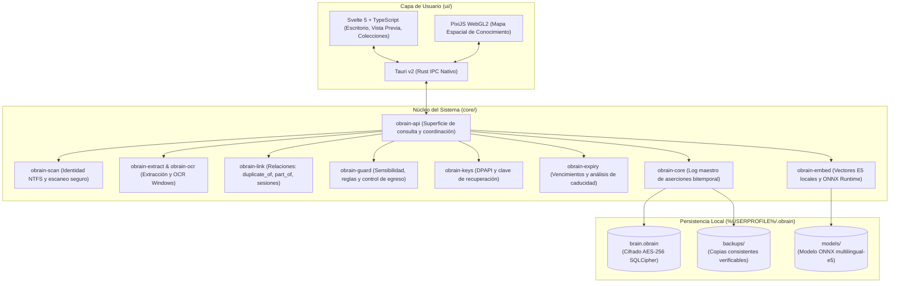

<div align="center">

# 🧠 Orchestrator's Brain

**Tu segundo cerebro. El que no olvida.**

*Una aplicación de escritorio local-first de conocimiento personal que no solo guarda tus archivos —entiende qué significan, cómo se relacionan y protege estrictamente tu privacidad.*

---

[](LICENSE)
[](#estado-actual-del-producto)
[](#arquitectura-técnica)
[](#arquitectura-técnica)
[](#privacidad-como-principio-no-negociable)

</div>

---

## 💡 La idea en una frase

> *«¿Dónde estaba el documento que usé para demostrar ingresos durante mi trámite de visa?»*

Esa pregunta no contiene necesariamente el nombre del archivo, ni su carpeta, ni su fecha exacta. Contiene una **relación** entre cosas que viviste: un documento, un trámite y un propósito.

Ningún explorador de archivos convencional responde a eso. **Orchestrator's Brain está diseñado para resolverlo.**

---

## 🤔 El problema

En tu computadora se acumulan cientos o miles de archivos: comprobantes, trámites, pólizas de seguro, facturas, recibos, notas, certificados y contratos.

Las herramientas actuales te permiten buscar por nombre de archivo o buscar por palabras sueltas si recuerdas el término exacto. Pero **todo el conocimiento contextual vive únicamente en tu cabeza**:

- Qué documento estaba dentro de un paquete PDF que presentaste en una cita consular.
- Qué recibos son copias idénticas guardadas en carpetas distintas.
- Qué póliza o documento de identidad está próximo a caducar.
- Qué archivos contienen contraseñas o datos bancarios y jamás deberían compartirse.

Si dependes de servicios en la nube para organizar esa información, tienes que ceder tu privacidad entregando tus documentos más delicados a servidores de terceros.

**Orchestrator's Brain nace para que tu propia computadora entienda tus documentos sin que ninguno de tus datos personales salga de tu máquina.**

---

## 🔒 Privacidad como principio no negociable

La arquitectura de Brain está diseñada desde el primer día para proteger datos reales de alta sensibilidad:

| Principio | Implementación real en Brain |
|---|---|
| **Local-first absoluto** | Todo el procesamiento (indexación, extracción, OCR, cálculo de relaciones y búsqueda) ocurre en tu máquina. |
| **Cifrado en reposo (SQLCipher)** | La base de conocimiento (`brain.obrain`) está cifrada en disco con AES-256 (SQLCipher). La llave se custodia mediante **Windows DPAPI** para tu usuario y se provee una **clave de recuperación** de 24 palabras por si reinstalas el sistema. |
| **Protección mediante PIN** | Puedes configurar un PIN de seguridad. Si el PIN está activo, el núcleo retiene y controla la exposición del contenido sensible y sus fragmentos (en búsquedas, vistas previas, detalles de entidad o apertura externa) hasta introducirlo. El acceso se revoca inmediatamente al bloquear la sesión de forma manual o transcurridos 5 minutos desde la autenticación (las lecturas no renuevan el plazo). |
| **Respaldos y restauración controlada** | Mecanismo integrado de copias de seguridad cifradas atómicas, verificación criptográfica (`PRAGMA integrity_check`, `PRAGMA cipher_integrity_check`) y restauración reversible con ensayo previo. |
| **Protección contra la nube** | Respeta archivos deshidratados de OneDrive/nube: detecta atributos de almacenamiento remoto y **nunca descarga archivos sin tu autorización expresa**. |
| **Sin telemetría ni cuentas** | Cero cuentas de usuario, cero servidores remotos, cero analíticas. |

---

## ✨ Capacidades del sistema

### 1. 🔍 Observar e identificar sin depender de nombres
El motor recorre las carpetas que indiques como **bibliotecas** e identifica cada archivo mediante su identidad física y hash de contenido. Si mueves un archivo de carpeta o lo renombras, Brain sabe que es el mismo y conserva todo lo que sabía sobre él. Y si borras un archivo, pasa a la **Papelera** de Brain durante 30 días antes de olvidar su texto, manteniéndose recuperable si lo restauras.

### 2. 📖 Extracción de texto y OCR local
- Extrae texto de archivos PDF, documentos de Office (OOXML), HTML y texto plano.
- **OCR 100 % local en Windows:** Para fotos, identificaciones y PDFs escaneados, utiliza el reconocedor nativo del sistema operativo (`Windows.Media.Ocr`). Ninguna imagen se envía a APIs externas.

### 3. ⏰ Detección y seguimiento de vencimientos
Detecta automáticamente fechas de caducidad en el texto (pólizas, identificaciones, pasaportes, contratos) analizando formatos de fecha, zonas MRZ (`P<MEX<<…`) y períodos de vigencia. El panel de Inicio te avisa en **«Caduca pronto»** de los documentos que vencen en los próximos 90 días o que ya han expirado, permitiéndote corregir o fijar fechas manualmente.

### 4. 🔗 Relaciones deterministas (sin alucinaciones de IA)
Antes de invocar modelos probabilísticos, el sistema descubre relaciones reales basadas en evidencia demostrable:
- **Duplicados exactos (`duplicate_of`):** Archivos idénticos con diferente nombre o ubicación.
- **Documento contenido dentro de otro (`part_of`):** Detecta cuando los párrafos de un archivo suelto forman parte integral de un PDF recopilatorio (por ejemplo, estados de cuenta dentro de un expediente de trámite), vinculando el origen con el paquete.
- **Sesiones de trabajo y versiones:** Documentos editados en ventanas de tiempo correlacionadas o con sufijos evolutivos.

### 5. 🗂️ Colecciones dinámicas y arrastre
Agrupa documentos en colecciones temáticas (como listas de reproducción) sin mover ni duplicar los archivos en tu disco. Puedes arrastrar documentos directamente a la barra lateral, buscar dentro de una colección y resaltar sus elementos en el mapa espacial.

### 6. 🛡️ Puerta de sensibilidad y clasificación
Clasifica automáticamente cada archivo en tres niveles:
- **Normal:** Documentos ordinarios.
- **Sensible:** Documentos con datos personales (identificaciones, contratos, datos financieros).
- **Bóveda:** Archivos con credenciales, claves privadas o secretos técnicos.

Puedes marcar carpetas enteras (como `Documentos de Identidad`) para que todo su contenido herede de forma permanente la etiqueta sensible. Lo que sea sensible no se expone sin PIN y lo que sea bóveda jamás entra a ningún índice derivado.

---

## 📈 Estado actual del producto

Orchestrator's Brain es un proyecto real, en desarrollo activo y con arquitectura formal documentada. Distinguimos de forma transparente lo implementado de lo planificado:

### ✅ Implementado y verificado (Versión 0.0.2)
- [x] Modelo de datos bitemporal inmutable basado en un log maestro de aserciones.
- [x] Cifrado en reposo con SQLCipher, protección de llaves con Windows DPAPI y clave mnemónica de recuperación.
- [x] Bloqueo por PIN con revocación inmediata en memoria y en consultas del núcleo.
- [x] Extracción documental y OCR local en Windows (`Windows.Media.Ocr`).
- [x] Búsqueda léxica de alto rendimiento (BM25) con evidencia de pasajes verificables.
- [x] Detección determinista de duplicados, paquetes (`part_of`), sesiones y vencimientos.
- [x] Interfaz de escritorio en Tauri v2 + Svelte 5 (escritorio por columnas, vista previa plegable, modo oscuro y claro, colecciones con arrastre y papelera).
- [x] Respaldos cifrados consistentes, verificación de integridad física y restauración controlada y reversible.
- [x] Rechazo de bases incompletas antes de escribir (`apertura_segura`).
- [x] Suite de más de 450 pruebas automatizadas en Rust y TypeScript.
- [x] Política permanente de CI en 3 niveles con verificaciones ligeras en Linux.

### ⚠️ Implementado con limitaciones conocidas
- **Búsqueda semántica vectorial:** El crate `core/obrain-embed` implementa la vectorización y búsqueda por significado con modelos ONNX (`multilingual-e5-small`). Funciona de forma totalmente local, pero requiere descargar previamente el modelo ONNX a `%USERPROFILE%\.obrain\models`.
- **Firma digital del instalador Windows (MSI):** El paquete MSI se compila con WiX Toolset y ha sido verificado en pruebas de instalación limpia y actualización desde 0.0.1. Actualmente se genera sin certificado comercial Authenticode (`--no-sign`), por lo que Windows SmartScreen puede mostrar una advertencia informativa durante la instalación manual.

### ⏳ Planificado en el Roadmap
- **M6 — Inferencia de procesos:** Agrupación autónoma de secuencias de trámites e hitos de vida a partir de grafos de relaciones.
- **M7 — Síntesis de respuestas con evidencia:** Responder preguntas abiertas complejas sintetizando fragmentos verificables («la pregunta de la visa»).
- **Sincronización multi-dispositivo:** Cifrada de extremo a extremo entre equipos personales.

---

## 🏗️ Arquitectura técnica

Brain separa estrictamente la superficie de persistencia, la lógica de negocio y la interfaz gráfica:



### Registro de decisiones de diseño (ADRs)
El repositorio cuenta con 36 decisiones formales de arquitectura registradas en [`docs/adr/`](docs/adr/), detallando el razonamiento técnico detrás de cada componente (elección de SQLite/SQLCipher, OCR local, diseño de aserciones, mitigaciones de AppData en Windows, etc.).

---

## 🛠️ Guía de inicio para desarrolladores

### Requisitos previos
- **Sistema operativo:** Windows 10/11 x64 (recomendado para la experiencia completa con OCR nativo y DPAPI). *El núcleo de Rust compila y pasa suites de prueba también en Linux.*
- **Rust:** Versión 1.85 o superior (edición 2024).
- **Node.js:** Versión 20 o 22 LTS y `npm`.
- **Strawberry Perl (en Windows):** Necesario para compilar OpenSSL embebido dentro de SQLCipher (`libsqlite3-sys`).
  ```powershell
  winget install StrawberryPerl.StrawberryPerl
  ```

### Clonación y configuración del entorno

```powershell
# 1. Clonar el repositorio
git clone https://github.com/jpgarcia04/Orchestrator-s-Brain.git
cd Orchestrator-s-Brain

# 2. Configurar el directorio de compilación recomendado
# Por el apóstrofo en el nombre del repositorio, se recomienda compilar fuera de la carpeta:
$env:CARGO_TARGET_DIR = "$env:USERPROFILE\obrain-target"
```

### Ejecutar la aplicación en desarrollo

```powershell
# Instalar dependencias del frontend
cd ui
npm install

# Lanzar la aplicación en modo desarrollo (Tauri + Vite)
npm run app
```

### Ejecutar la CLI de Brain

```powershell
# Desde la raíz del repositorio:
cargo run --manifest-path core/Cargo.toml --release -p obrain-api --bin obrain -- --help

# Indexar una carpeta de prueba:
cargo run --manifest-path core/Cargo.toml --release -p obrain-api --bin obrain -- indexar "C:\Ruta\A\Tu\Carpeta"
```

### Verificaciones y pruebas locales

El repositorio incluye un script unificado de verificación local que respeta la política de eficiencia de CI sin alterar tu base de datos personal:

```powershell
# Verificación rápida de política CI y coherencia de versiones (< 5 segundos):
./tools/verificar-local.ps1 -SoloPoliticaCI

# Verificación estándar de desarrollo (formato Rust, svelte-check, tests unitarios de UI y build Vite):
./tools/verificar-local.ps1

# Verificación completa (incluye pruebas de coherencia en Rust):
./tools/verificar-local.ps1 -Completo
```

---

## 🖼️ Demostración visual

> **Nota sobre privacidad:** Para garantizar la protección de datos personales, cualquier material gráfico de Brain se genera exclusivamente a partir de la biblioteca de pruebas sintética ([`tests/fixtures/producto-windows/`](tests/fixtures/producto-windows/README.md)).

```
[Próximamente: Capturas de la interfaz con datos sintéticos]
1. Escritorio principal con colecciones, barra lateral y tarjetas de caducidad.
2. Vista previa de documentos con relaciones detectadas (part_of y duplicados).
3. Buscador por significado y pasajes verificables.
4. Mapa espacial interactivo (PixiJS).
```

---

## 📄 Licencia y Atribuciones

Este proyecto se distribuye bajo la licencia **MIT**. Consulta el archivo [`LICENSE`](LICENSE) para más detalles.

### Componentes de terceros y agradecimientos
- **[Tauri](https://tauri.app/):** Marco de trabajo para aplicaciones de escritorio ligeras y seguras.
- **[SQLCipher](https://www.zetetic.net/sqlcipher/) / [rusqlite](https://github.com/rusqlite/rusqlite):** Motor de base de datos cifrado en reposo mediante AES-256.
- **[Svelte](https://svelte.dev/):** Entorno reactivo para la interfaz de usuario.
- **[PixiJS](https://pixijs.com/):** Motor de renderizado acelerado por WebGL2 para el mapa de conocimiento.
- **[ONNX Runtime](https://onnxruntime.ai/) & [multilingual-e5-small](https://huggingface.co/intfloat/multilingual-e5-small):** Motor de inferencia y modelo de embeddings semánticos locales.

---

<div align="center">

*Construido con la convicción de que tu computadora debería conocerte mejor — sin necesidad de contarle nada a nadie más.*

**[🧭 Estado del Proyecto](docs/ESTADO.md)** · **[📖 Documento Maestro](docs/PROJECT-MASTER.md)** · **[📋 Decisiones Arquitectónicas (ADRs)](docs/adr/)** · **[⚙️ Política de CI](docs/POLITICA-CI.md)**

</div>